<div align="center">



[](https://www.linkedin.com/in/praveenkumar-byrapuneni/)
[](mailto:praveenkumarbyrapuneni@gmail.com)
[](https://github.com/Praveenkumarbyrapuneni)

</div>

I design backend systems and the architecture around them: multi-tenant RAG pipelines, agent orchestration, fine-tuned models and the automation that connects them to real client products. Most of my work lives in private client repos. Below is what is public.

<div align="center">

<br/><sub>Refreshed daily by a Node.js GitHub Action in this repo, using the GitHub API.</sub>
</div>

## What I build

<table>
<tr>
<td width="33%" valign="top">

**RAG and document intelligence**

Multi-tenant financial RAG. Hybrid BM25 and dense retrieval, LangGraph orchestration, hierarchical chunking and custom LLM evaluation. Built for 10M+ documents with no cross-tenant leakage.

<sub>Python, LangGraph, Qdrant, Cohere, AWS Bedrock, PostgreSQL, Redis, FastAPI</sub>

</td>
<td width="33%" valign="top">

**Backend and automation**

End-to-end workflows that connect LLMs to client systems and external APIs: campaigns, data pipelines, content automation and LLM features inside client products.

<sub>n8n, Docker, Python, AWS Lambda, REST APIs, Claude, GPT-4</sub>

</td>
<td width="33%" valign="top">

**LLM fine-tuning**

Qwen3 fine-tuned with QLoRA for financial sentiment, earnings call summaries and SEC filing Q&A. Data prep, training, evaluation, vLLM serving and A/B tests against GPT-4o.

<sub>Python, HuggingFace, QLoRA, vLLM, FastAPI, MLflow, GCP</sub>

</td>
</tr>
</table>

## Featured systems

### [enterprise-rag-agents](https://github.com/Praveenkumarbyrapuneni/enterprise-rag-agents)

Document intelligence for financial institutions. It answers questions grounded in live transaction data and indexed policy documents, with inline citations and a compliance audit log.

<details>
<summary><b>Show the retrieval pipeline</b></summary>

```
SEC filings, earnings reports, policy docs, live transactions
                        ↓
          Query classification (Claude Haiku)
                        ↓
        BM25 sparse  +  dense vectors (Cohere)
        Reciprocal rank fusion → Cohere rerank
        MMR dedup → parent-child chunk expansion
                        ↓
    Claude Sonnet synthesis → Claude Haiku evaluation
                        ↓
       Grounded answer + inline citations + audit log
```

- HyDE is turned off for numerical queries
- Tenant isolation is enforced at the vector layer
- 14 security vulnerabilities found and fixed
- Moves from laptop to AWS with no code changes

</details>

### [llm-fine-tuning](https://github.com/Praveenkumarbyrapuneni/llm-fine-tuning)

Qwen3 fine-tuned on financial data with QLoRA: three tasks, three LoRA adapters, one base model.

<details>
<summary><b>Show the training pipeline</b></summary>

```
76,000 financial headlines + earnings transcripts + SEC filings
                        ↓
       Data prep → label normalization → Qwen3 chat format
                        ↓
        Qwen3 in 4-bit (QLoRA) + blank LoRA adapter
                        ↓
           3 epochs, lr=2e-4, rank=16, GCP GPU
                        ↓
        Accuracy eval → vLLM serving → FastAPI endpoint
                        ↓
       A/B test: fine-tuned Qwen3 vs GPT-4o on cost and speed
```

- 5 GB of GPU memory instead of 160 GB for a full fine-tune
- Apache 2.0, so it is clean for commercial use

</details>

## How I design a system

<details>
<summary><b>The questions every design has to answer before I write code</b></summary>

<br/>

1. What breaks this at 10x load?
2. What happens when a dependency goes down?
3. Where does it waste money if it keeps running wrong?
4. Where does it leak data if it is misconfigured?
5. What does the rollback look like in production?

The approach that survives the most of these at the lowest cost wins. I pair with Claude Code throughout: research, design review, implementation and a security pass before anything ships.

</details>

## Stack

<div align="center">


</div>

<div align="center">
<picture>
  <source media="(prefers-color-scheme: dark)" srcset="https://raw.githubusercontent.com/Praveenkumarbyrapuneni/praveenkumarbyrapuneni/output/github-contribution-grid-snake-dark.svg" />
  
</picture>
</div>
